  <picture>
    <source media="(prefers-color-scheme: dark)" srcset="./assets/astro-lab-v4-dark.svg">
    <source media="(prefers-color-scheme: light)" srcset="./assets/astro-lab-v4.svg">
    
  </picture>

### Building software that turns ideas into real-world impact.

Backend developer with ~4 years designing business-critical systems on **Odoo 16, 17, 18 and 19** —
custom modules, complex business logic, integrations and version migrations that keep companies running.
I don't stop at ERP: I build where software meets the physical world.

- 🚀 **Now building:** **Agrobot** — Odoo, robotics and computer vision working together for smarter agriculture.
- 🧠 **Exploring:** FastAPI, scalable backend architectures, Machine Learning and computer vision (migrating to YOLO / Ultralytics).
- 🤝 **Open to:** collaborating on ambitious projects in Python and Java Web.
- 🧱 **Off the clock:** big Lego fan — I like building things, one block at a time.
- 📫 **Let's talk:** almoller622@gmail.com

<!---
AlfredMoller/AlfredMoller is a ✨ special ✨ repository because its `README.md` (this file) appears on your GitHub profile.
You can click the Preview link to take a look at your changes.
--->

 <!---->

  

